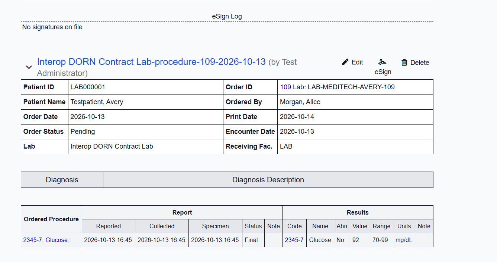
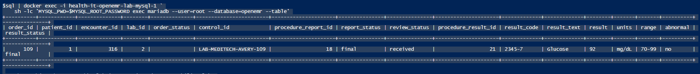

# Clinical Interface Operations Case Study

## Synthetic HL7 ORU source onboarding: Mirth Connect to OpenEMR

This case study documents a synthetic laboratory result moving through an HL7 interface, interface audit storage, a guarded delivery step, and an OpenEMR provider view. It is written to demonstrate practical application support skills: readiness checks, test execution, message tracing, identity and result reconciliation, operational safeguards, and clear communication of an unresolved issue.

> **Environment and data:** This is a local portfolio simulation using synthetic data. The source is MEDITECH Expanse-style; it is not a MEDITECH system and has no connection to Warren Hospital or any production clinical environment. Patient Avery Testpatient and all identifiers are synthetic.

## What was demonstrated

| Area | Evidence in this exercise |
|---|---|
| Interface readiness | Mirth MLLP listener on host port `6662` was reachable during the focused regression run. |
| HL7 source validation | Synthetic `ORU^R01` result with patient, order, LOINC, value, units, range, abnormal flag, and final status was accepted and persisted by Mirth. |
| Audit and message tracing | Mirth logs identified the runtime message control ID, patient and order context, validation outcome, PostgreSQL message ID, and ACK policy decision. |
| Downstream delivery | Guarded delivery utility reported `DELIVERED` for OpenEMR order `109`; its response included the persisted result fields. |
| Clinical application view | OpenEMR displayed the final Glucose result, `92 mg/dL`, range `70–99`, abnormal `No`. |
| Data reconciliation | A read-only database query matched the order, patient, encounter, lab, report, and result identifiers and values. |
| Workflow control | The order remained Pending and the eSign log showed no signatures; the result was not signed or marked reviewed. |

## Data flow

1. **Synthetic source message.** A source-controlled scenario represents a MEDITECH Expanse-style final glucose result for synthetic patient `LAB000001`, with placer order `ORD-MEDITECH-AVERY-109`, filler order `LAB-MEDITECH-AVERY-109`, LOINC `2345-7`, value `92`, units `mg/dL`, range `70-99`, normal flag `N`, and result status `F`.
2. **Mirth intake and validation.** The scenario is sent over MLLP to the `ORU_R01_IN` channel on host port `6662`. Mirth extracts the message context, validates the message, and records accepted message and observation data in the PostgreSQL interoperability database.
3. **OpenEMR delivery eligibility.** An explicit target mapping associates the placer order with OpenEMR order `109`. The local database trigger creates a delivery item when an accepted ORU is inserted while that mapping is active. Registering the mapping after a message has already been inserted does not backfill that earlier message.
4. **Guarded delivery.** The delivery utility claims the eligible item, validates the target identity, and invokes the local OpenEMR receiver. This step reported `DELIVERED` with delivery ID `5`.
5. **Persistence and provider view.** OpenEMR stored a final report and result. The database row and provider-facing order view agree on the glucose code, value, units, reference range, and normal interpretation.

## Recorded validation and outcome

### Focused automated regression

On October 13, 2026, the source contract and live ORU scenario tests completed with **8 passed in 5.95 seconds**. The run covered six accepted ORU runtime scenarios and two source-contract tests. This is regression evidence for the Mirth ORU interface; it is distinct from the later order-109 delivery evidence below.

### Order 109 runtime trace

On October 14, 2026, the source-specific sender timed out waiting for MLLP acknowledgment bytes. Mirth logs nevertheless showed the message was accepted, validated, persisted as `oru_message_id=52`, and that the postprocessor selected `AA`. The log records the intended ACK policy decision; it does **not** establish that ACK bytes reached the sender.

With the target mapping active, the guarded delivery command then completed successfully:

```text
status: DELIVERED
delivery_id: 5
order_id: 109
placer_order_number: ORD-MEDITECH-AVERY-109
report_status: final
review_status: received
result_code: 2345-7
result_text: Glucose
result: 92
units: mg/dL
range: 70-99
abnormal: no
result_status: final
```

The persisted OpenEMR row identified patient `1`, encounter `316`, lab `2`, report `18`, and result `21`. The provider view showed the same result. The order header remained Pending and no e-signature was present.

### Known issue: sender did not receive the MLLP ACK

The sender timeout is a real, unresolved transport/response issue. The evidence separates three facts:

- Mirth accepted and persisted the ORU.
- Mirth's postprocessor selected ACK code `AA`.
- The sending process received no response bytes before timing out.

The data was later delivered to OpenEMR through the guarded delivery workflow, but that does not resolve or prove successful MLLP ACK transmission. Do not describe the sender/ACK exchange as passing end to end. Further diagnosis should inspect the deployed response behavior before additional retries; a blind resend could create duplicate or conflicting workflow activity.

## Evidence screenshots

The screenshots below are the provider-view and database-side evidence for order `109`. They contain synthetic test data.

### OpenEMR provider view



### OpenEMR persistence query



## Reproduction notes

Run commands from the repository root in PowerShell. The order-109 execution is recorded evidence against a local test chart; it should not be repeated against that same order without first reviewing its existing report/result state and the delivery guard.

Focused regression command:

```powershell
$base = Join-Path $env:TEMP ("pytest-oru-" + [guid]::NewGuid().ToString("N"))
python -m pytest -q `
    .\tests\interoperability\test_live_oru_scenario_contract.py `
    .\tests\interoperability\test_meditech_style_source_contract.py `
    --basetemp $base
```

The recorded delivery command was:

```powershell
python -m scripts.hl7.mirth_openemr_delivery deliver `
    --placer-order ORD-MEDITECH-AVERY-109 `
    --confirm-order-id 109 `
    --openemr-container health-it-openemr-lab-openemr-1
```

The focused test command validates the Mirth ORU scenario suite. The delivery command validates the queued OpenEMR handoff. They are separate checks; the sender timeout means the full sequence did not complete as a single successful MLLP request/ACK transaction.

## Relevance to clinical applications support

This exercise demonstrates a support-oriented method for following a clinical result across system boundaries: verify listener readiness, inspect message-level processing, correlate patient and order identity, distinguish interface acceptance from downstream delivery, reconcile persisted values with the application view, preserve human review controls, and document a remaining defect without overstating the result.

It is a technical portfolio demonstration, not formal end-user UAT. No end-user acceptance session, production change, hospital workflow approval, or Warren-specific system validation occurred.

## Repository evidence map

| Artifact | Purpose |
|---|---|
| `fixtures/hl7/oru/scenarios/meditech-expanse-style-glucose-final-openemr-avery.json` | Synthetic source scenario |
| `tests/interoperability/test_meditech_style_source_contract.py` | Source-specific fixture contract checks |
| `tests/interoperability/test_live_oru_scenario_contract.py` | Live Mirth ORU runtime regression scenarios |
| `scripts/hl7/run_oru_scenarios.py` | Sends scenarios to Mirth and reconciles accepted interface data |
| `scripts/hl7/mirth_openemr_delivery.py` | Registers guarded targets and delivers eligible accepted ORUs to local OpenEMR |
| `infrastructure/mirth/channels/ORU_R01_IN.xml` | Source-controlled Mirth ORU channel configuration |
